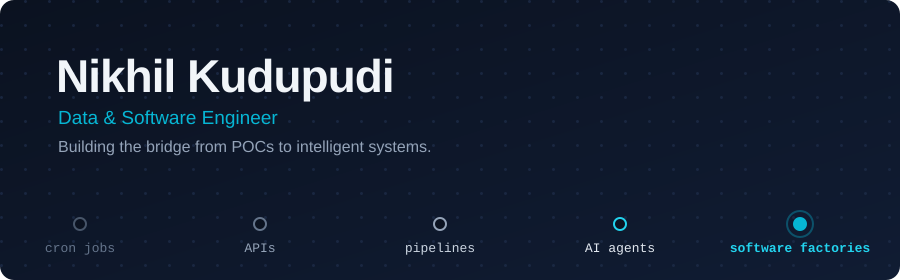

 

 

| **20M+** | **88+** | **+25%** | **2.5+ yrs** |
| :---: | :---: | :---: | :---: |
| records matched | fintech clients served | workflow automation | building in production |

 

## About

I'm a data and software engineer who likes to build things end to end: backend, data and AI in one product. I've done that in finance, first as a backend engineer on a portfolio-management platform, then as a data engineer matching millions of addresses on AWS.

Right now I'm finishing an **M.S. in Data Analytics Engineering at Northeastern University** (GPA 3.9, Boston).

Automation is what hooked me. It started with cron jobs, moved to APIs, then data pipelines, then AI agents. Now I'm exploring **software factories**: systems that build and ship the software themselves.

 

## Selected work

| Project | What it does | Stack |
| :-- | :-- | :-- |
| **[SEC EDGAR Financial Lakehouse](https://github.com/Nikhil-Kudupudi/SEC_EDGAR)** | Medallion pipeline that turns SEC filings into executive KPIs. Every dashboard number traces back to its source filing. | `PySpark` `Polars` `S3` `Parquet` `Streamlit` |
| **Job Copilot** | Paste a job description. Get a repeatable fit score and a tailored one-page resume, logged to a sheet. | `Cloudflare` `LLM agents` `Structured outputs` |
| **Real-Time News Analytics** | Streaming pipeline with live topic ingestion and sentiment analysis. | `Kafka` `Spark Streaming` `Delta Lake` `dbt` |
| **Modular RAG Chatbot** | Dockerized, GCP-native RAG app with configurable content sources. | `Prefect` `MLflow` `GCP` `Docker` |
| **Reddit Data Pipeline** | ETL over thousands of daily records, ending in BI-ready tables. | `Airflow` `S3` `Glue` `Redshift` |

More on the [portfolio](https://nikhil-kudupudi.github.io/Portfolio/#projects).

 

## Where I've worked

| | Role | |
| :-- | :-- | :-- |
| **Plymouth Rock Assurance** | Data Engineer | Boston · 2026 |
| **KFin Technologies** | Fintech Engineer | Hyderabad · 2023 – 2024 |
| **WebileApps** | Software Engineer | Hyderabad · 2022 – 2023 |

 

## Stack

 

## Let's talk

If you have a problem with clear requirements and need technical help, I'd like to hear about it. Open source, startups and enterprise work are all welcome.

 

*Built with intention.*

